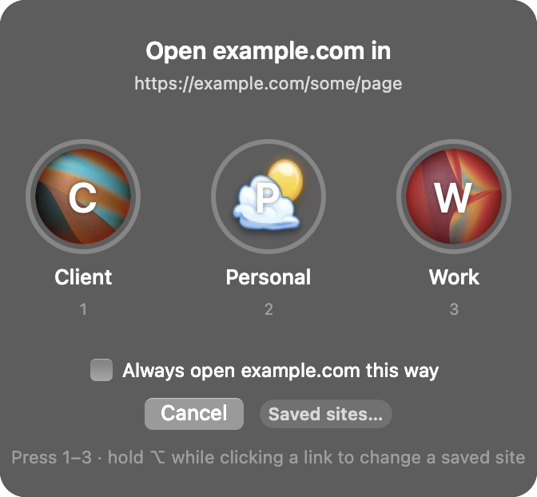

# Profiley

On a Mac, links from Slack, WhatsApp, Claude and other apps open in whichever browser profile is in front, not the one they belong to. Profiley becomes your default browser and sends each link to the right profile: sites you've saved open straight in theirs, and anything else asks you.



- A link from another app shows your profiles, with the same avatars as your browser. Click one or press 1, 2, 3.
- Tick "Always open this site this way" and that site skips the popup from then on. A saved site covers its subdomains too, so `example.com` also catches `app.example.com`. Leave it unticked for sites you use in several profiles, like github.com.
- Hold Option while clicking a link to get the popup anyway, to pick a different profile or press Forget on a saved site.
- Open Profiley from Spotlight (or press "Saved sites…" in the popup) to see every saved site, change which profile it opens in, remove it, or add one by hand.

Works with Comet, Google Chrome, Brave, Microsoft Edge and Vivaldi.

## Install

Needs macOS 12 or later.

1. Download [Profiley.zip](https://github.com/kamal0808/profiley/releases/latest/download/Profiley.zip), unzip it and drag Profiley into Applications.
2. Open it. macOS will say it can't check it for malware, because the app isn't notarized by Apple yet. Go to System Settings → Privacy & Security, scroll down and press "Open Anyway".
3. The Saved sites window opens; press "Make default browser" and confirm.

It uses the browser that was your default when you first opened it, with that browser's profiles. If your default was Safari, Firefox or Arc, it uses the first supported browser installed. To switch: `defaults write com.kamalkhatwani.profiley browser "Google Chrome"` (or "Comet", "Brave Browser", "Microsoft Edge", "Vivaldi"), then open Profiley again.

### Build from source

Needs the Xcode command line tools (`xcode-select --install`):

```sh
git clone https://github.com/kamal0808/profiley
cd profiley
./install.sh                          # uses your current default browser
./install.sh --browser "Google Chrome"  # or pick one
```

Then press "Make default browser" as above. You can also pick it in System Settings → Desktop & Dock → Default web browser.

Saved sites live in `~/Library/Application Support/Profiley/sites.json`.

### Coming from Finicky

If you used the older Finicky-based version (Finicky Picker), the first launch copies the sites from the `learned` block of `~/.finicky.js`. Add any other rules by hand in the Saved sites window. Once Profiley is your default browser, quit Finicky and remove it (`brew uninstall --cask finicky`, or drag it to the Trash) and `~/.finicky.js`.

## Known limits

- One browser at a time.
- Saved sites match by domain only, not by words in the path.
- Comet avatars come from fixed resource ids inside Comet; a Comet update can move them, and the picker then shows coloured circles instead.

Made from an idea on [Ideato](https://www.ideato.social/idea/568b7025-083b-4f47-8a0c-e4912da28894). MIT licensed.
